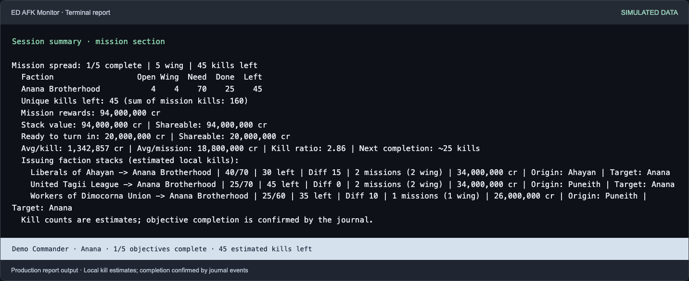
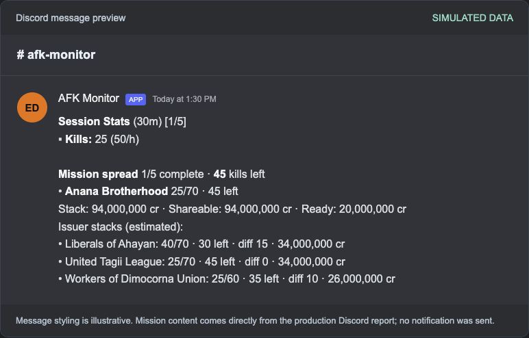

# Elite Dangerous AFK Monitor

Real-time monitoring of Elite Dangerous journal files for logging AFK massacre farming events as they happen. Output is to terminal, Telegram, Discord channel/thread or Discord with a user ping and each level can be configured on a per-event basis.

**Terminal mission stack report**



**Discord session message preview**



*Simulated mission data rendered with the current report functions. Discord styling
is illustrative; these examples do not send notifications. See
[regenerating the previews](docs/screenshots.md) to refresh them after report changes.*

## Contents
- [Elite Dangerous AFK Monitor](#elite-dangerous-afk-monitor)
  - [Contents](#contents)
  - [Events and information logged](#events-and-information-logged)
    - [Plus realtime reporting of...](#plus-realtime-reporting-of)
  - [Getting started](#getting-started)
    - [Standalone (EXE) version](#standalone-exe-version)
    - [Python version](#python-version)
  - [Telegram and reliable delivery](#telegram-and-reliable-delivery)
  - [Following game restarts](#following-game-restarts)
  - [Wing mission stacks](#wing-mission-stacks)
  - [Testing and updating](#testing-and-updating)
  - [Development checks](#development-checks)
  - [Configuring log levels](#configuring-log-levels)
  - [Launch Arguments](#launch-arguments)
  - [Service mode](docs/service-mode.md)
  - [Common Issues](#common-issues)
    - [No new terminal output during a live session](#no-new-terminal-output-during-a-live-session)
    - [Some kills are not being logged](#some-kills-are-not-being-logged)
    - [Ships scans are reported when manually scanned](#ships-scans-are-reported-when-manually-scanned)
    - [Ship or fighter hull damage not logged](#ship-or-fighter-hull-damage-not-logged)
    - [Stolen cargo notifications when ejecting cargo](#stolen-cargo-notifications-when-ejecting-cargo)
    - [Telegram certificate verification fails](#telegram-certificate-verification-fails)
    - [Garbled characters or repeated lines in terminal output](#garbled-characters-or-repeated-lines-in-terminal-output)

## Events and information logged
- Outgoing ship scans (by player or by NPC pilot in fighter)
- Incoming scans of ship cargo by pirates
- Bounties (i.e. kills) incl. faction and time since previous
- Kill/bounty/merit summary and recent average rates
- Wing mission stacks by issuing faction, kill progress, remaining kills and stack differences
- Total/shareable mission rewards and value ready to turn in
- Mission origins, destinations, expiry and individual payouts
- Ship shields down/restored
- Ship/fighter hull damage
- Ship/fighter destroyed
- Pirates not engaging due to low cargo value
- Cargo stolen
- Fuel reserves low/critical
- Warnings about hostile security forces
- Low kill rate per hour warnings
- No kills in x minutes warnings

### Plus realtime reporting of...
- Kill rate, elapsed time since last kill & number of kills
- Cargo scan rate, elapsed time since last scan & number of scans
- Session time
- Mission status

## Getting started

The wing mission stacks, Telegram, journal-following and plain-output changes in this fork are available
from this branch's source code. Upstream standalone releases do not include them.
Keep `afk_monitor.py`, `notifications.py`, `outbox.py`, `missions.py`,
`journal_reader.py`, and `terminal_output.py` together when running from source.

**Python version**: Use this fork’s source build for the features documented here.

**Standalone (EXE) version**: The upstream build is available below; its feature set differs from this fork.

> ℹ️ AFK Monitor uses features of modern terminal emulators such as [Windows Terminal](https://apps.microsoft.com/detail/9n0dx20hk701). Functionality will be degraded with older software such as the the Windows 10 console. For more information see [Terminal Support](https://github.com/PsiPab/ED-AFK-Monitor/wiki/Terminal-Support).

### Standalone (EXE) version

- Download and extract `afk_monitor_standalone.7z` from [releases](https://github.com/PsiPab/ED-AFK-Monitor/releases) to a folder
- Copy `afk_monitor.example.toml` and rename the copy to `afk_monitor.toml`
- (Optional) For Discord support edit `WebhookURL` and `UserID` under `[Discord]` in `afk_monitor.toml`
- Start Elite Dangerous then run `afk_monitor.exe`

For more detailed instructions see [Basic Setup](https://github.com/PsiPab/ED-AFK-Monitor/wiki/Basic-Setup).

### Python version

Requirements: [Python 3.12+](https://www.python.org/downloads/), [discord-webhook](https://github.com/lovvskillz/python-discord-webhook) (optional, required for Discord support)

Optional extras (Discord, PNG recap cards) are listed in `requirements.txt`; a `Dockerfile` and a `pyproject.toml` are included for headless and packaged setups.
- Download or clone [this fork's source](https://github.com/sidonsoft/ED-AFK-Monitor), select the branch you want to test, and keep the entire extracted folder
- Copy `afk_monitor.example.toml` and rename the copy to `afk_monitor.toml`
- (Optional) For Discord support edit `WebhookURL` and `UserID` under `[Discord]` in `afk_monitor.toml`
- Start Elite Dangerous then double-click `afk_monitor.py` *or* open a terminal and run `py afk_monitor.py`
  
## Telegram and reliable delivery

Telegram support is included without additional Python dependencies. Create a bot with
[@BotFather](https://t.me/BotFather), open a chat with your bot, and send `/start`.
Set `BotToken` and your numeric `ChatID` under `[Telegram]` in `afk_monitor.toml`.
Group chat IDs may be negative. You can supply the token through the
`ED_AFK_TELEGRAM_TOKEN` environment variable instead of saving it in the config.
Profile overrides work the same way as Discord settings.

Events at log level 2 or 3 are delivered to both configured services. Telegram uses
plain text; level 3 adds a mention only on Discord. Run with `--test` to preview
Discord, Telegram, and Discord live updates without sending notifications.

Each destination has an independent background worker, a 200-message queue, and a
five-second request timeout. Temporary connection errors, HTTP 429, and server errors
are retried up to three attempts. Server-requested retry delays are respected and can be interrupted at shutdown. Permanent
errors and full queues are reported in the terminal. Shutdown allows six seconds to
finish delivery and reports any pending messages.

Undelivered messages are saved before they are sent to
`pending_notifications/<profile>/` next to `afk_monitor.toml`, so a crash or shutdown
does not lose them. Saved messages are replayed in order on the next start, kept for
up to 24 hours and capped at 200 per destination. Permanent failures (for example an
invalid token or chat ID) are reported and removed; a message whose retries run out
while the service is unreachable stays saved for the next start. Saved files contain
the notification text, so delete that directory if you do not want it retained.
Live-stat updates are not saved because each new update replaces the previous one.
A timeout after a service accepted a message can still result in a duplicate on retry.

## Following game restarts

Normal monitoring follows newer journals automatically, reading each from the start
after draining the previous file. It stays running after the game exits, ready for
the next launch. Session statistics end on game shutdown; cumulative totals remain
for the monitor's lifetime. A commander change stops the monitor so it can be restarted
with the correct configuration profile. Discord forum logging continues in its existing
thread for the monitor's lifetime.

Use `--no-follow`, `--setfile`, or `--fileselect` to keep monitoring a single journal.
An unfinished final event is retained until its terminating newline arrives. If a newer
journal appears while a line is unfinished, the monitor waits briefly for the writer and
then switches, so an abandoned partial write cannot block following; that unfinished
event is discarded.

## Wing mission stacks

Track massacre missions using the game's journals, with an Elite Tracker style
breakdown in terminal and notification summaries. Elite Tracker does not need to run.
The report includes issuer stacks, required and estimated kills, remaining kills,
stack differences, total/shareable rewards and value ready to turn in. The detailed
mission list also shows origins, destinations, expiry and individual payouts.

```powershell
py afk_monitor.py --missions
py afk_monitor.py --missions --json
```

These commands read saved ledgers and exit without contacting Discord/Telegram.
Start the monitor normally first to load or refresh mission details. In the existing
`[LogLevels]` section, `SummaryMissions = 2` enables terminal and configured notification
summaries; `1` selects terminal only and `0` hides the block.

Missions from the same issuer add together; different issuers progress in parallel
against the same target faction. For example, 40 + 30 kills from issuer A and 50
from issuer B require 70 unique kills. Progress is estimated from local bounty events;
`MissionRedirected` confirms objective completion. Wing members' kills and missing
journal events can make estimates differ from the game. Upgrades preserve old saved
estimates rather than retroactively correcting them.

See the [wing mission stack guide](docs/wing-missions.md) for field definitions,
worked calculations, saved-state recovery, imports and accuracy limits. Long Discord
reports are abbreviated; use the saved report or JSON for the full list.

## Testing and updating

See [testing, updates and rollback](docs/testing-and-updates.md) for source installation,
backup steps, checks, live verification and the gaming-PC backup location. Updates
use your existing settings and mission ledger. This build reports completion; it
does not exit the game or turn in missions automatically.
Prefer an always-on box? The [service mode guide](docs/service-mode.md) covers systemd, launchd, Task Scheduler and Docker setups.

## Configuring log levels

Each type of event can be set to one of four additive output levels: nothing (0), terminal (1), terminal plus configured Discord and Telegram destinations (2), or the same with a Discord user ping (3). These can be configured by editing the values in `afk_monitor.toml` under the section `[LogLevels]`. Each event type is described in the config file.

Defaults are intended to be sensible for those new to AFK. For example, scans of hard ships are logged to Discord to aid with avoiding difficult instances.

To reset any log levels to defaults simply copy the appropriate values from `afk_monitor.example.toml`.

## Launch Arguments

You can pass the following arguments when launching AFK Monitor:
```
-p, --profile <profile_name>                  Load a specific profile for config settings
-j, --journal <journal_folder_path>           Override for path to journal folder
-w, --webhook <webhook_url>                   Override for Discord webhook URL
-r, --resetsession                            Reset session stats after preloading
-t, --test                                    Preview notifications in terminal without sending
-d, --debug                                   Print information for debugging
-s, --setfile <journal_file_path>             Set specific journal file to use
-f, --fileselect                              Show list of recent journals to chose from
--telegram-token <token>                     Override Telegram bot token
--telegram-chat <id>                         Override Telegram chat ID
--no-follow                                 Monitor only the selected journal
--no-hotkeys                                Disable [s]tatus [m]issions [u]mute hotkeys
--instance <label=folder>                 Watch several journal folders at once (repeatable)
--plain                                     Plain text without colours, emojis or live status
--missions                                  Print saved massacre-mission spread and exit
--wing                                      With --missions, merge shared wing ledgers
--wing-url <URL>                           With --wing, also merge ledgers fetched from a relay (repeatable)
--wing-push <BASE_URL>                     Upload local ledgers to a relay (HTTP PUT), then exit
--history                                   Print saved session history and exit
--json                                      With --missions/--history, print JSON output
--import-missions <file>                    Import a mission list (CSV or text) and exit
--set <Section.Key=value>                   Override a config setting for this run
--save <Section.Key=value>                  ...and persist it into afk_monitor.toml (comments kept)
--export <file>                           With --history, write sessions to .json/.csv/.png
--share                                   With --history, print a compact shareable recap
--dashboard <port>                        Serve a read-only web dashboard locally
--dashboard-token <token>                 Protect the dashboard for share links
--dashboard-host <address>                Bind address (0.0.0.0 shares on the LAN)
```

## Common Issues

### No new terminal output during a live session

By default AFK Monitor starts with your latest journal and follows newer files automatically, including while waiting for the game to load. Check the journal folder/file printed at startup if events are missing. Use `--journal <folder>` for a different journal folder, `--setfile <full-path>` for a particular file, or `--fileselect` to choose from recent journals. Explicit file selections stay fixed rather than following new files. A journal folder with no journal files yet still requires starting the game once.

### Some kills are not being logged

ED does not log all bounties either in-game or to the journal (anywhere from 0-30% are missed). This is a game limitation. However, these 'ghost' kills are still counted towards your mission completions if they are for the target faction.

### Ships scans are reported when manually scanned

Scans by your NPC pilot are logged just like any other scans. To avoid erroneous logging of scans (e.g. of system security) while using AFK Monitor set and use a key bind for 'select next hostile target' instead of scanning any target. To silence all outgoing scan notifications, set `ScanEasy = 0`, `ScanHard = 0`, and `SecurityScan = 0` under `[LogLevels]`. Incoming pirate cargo scans are controlled separately by `ScanIncoming`.

### Ship or fighter hull damage not logged

ED only records hull damage in 20% increments, so if your ship or fighter hull was reduced to 81% for example that wouldn't be reported. Further damage that reduces the hull below 80% (or 60%, 40%, 20%) would be logged.

### Stolen cargo notifications when ejecting cargo

ED's journal does not distinguish a single unit jettisoned by the player from cargo stolen by a hatch breaker limpet. These notifications now say **Cargo lost or jettisoned (possible theft)**. To avoid a warning when disposing of cargo, use 'Abandon' instead of 'Jettison', or jettison more than one unit at a time. Set `CargoLost = 0` under `[LogLevels]` to disable these alerts entirely.

### Telegram certificate verification fails

Some bundled Python runtimes do not have a working root-certificate store. Certificate
failures are reported as a setup error rather than retried as a temporary outage.
Repair the runtime's certificate installation, or set `SSL_CERT_FILE` to the full path
of a trusted PEM CA bundle before starting the monitor. Python/OpenSSL uses this
[certificate-file setting](https://docs.python.org/3/library/ssl.html#ssl.get_default_verify_paths)
for its default HTTPS context. A bundle already installed with Requests/Certifi may
be suitable; the path is specific to the Python environment. Certificate and hostname
verification remain enabled. Discord and Telegram can use different certificate
stores, so working Discord delivery does not establish that Telegram's store works.

### Garbled characters or repeated lines in terminal output

Use `--plain` for text without colours, emojis, cursor controls, or the live status line. Plain output is selected automatically for redirected output, `TERM=dumb`, or Windows consoles where virtual-terminal support cannot be enabled. It uses ASCII text, so accented names are simplified in the terminal; notifications retain their original text. This avoids registry edits and repeated status lines. Modern consoles keep formatted live output, and narrow/resized windows are handled safely. [Windows Terminal](https://apps.microsoft.com/detail/9n0dx20hk701) remains an option for full formatting; the upstream [Terminal Support](https://github.com/PsiPab/ED-AFK-Monitor/wiki/Terminal-Support) page describes older releases.

## Development checks

Run `python -m unittest discover -s tests -v` with Python 3.12 or newer.
Tests use simulated journals and mocked transports; they do not send notifications.

Automated regression checks run on Windows, macOS and Linux with Python 3.12 and 3.13.
